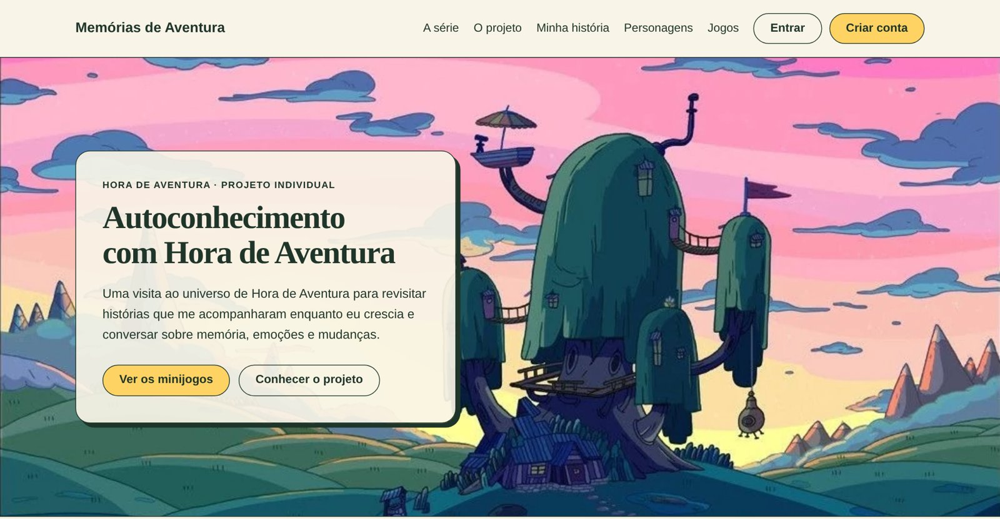
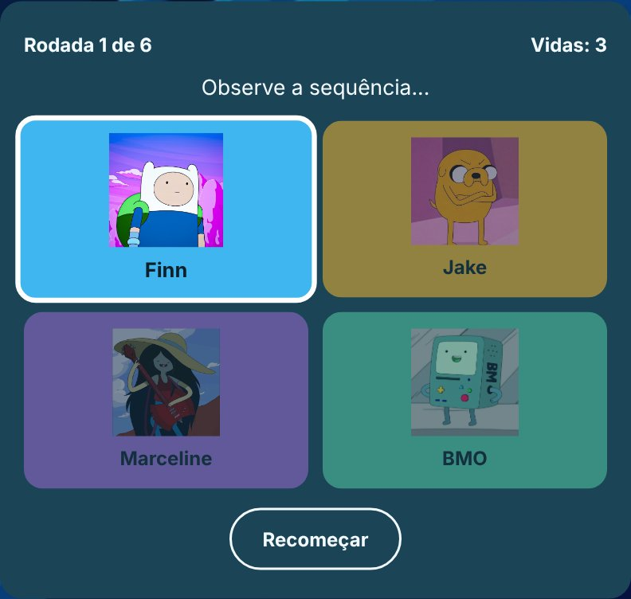

# 🗡️ Memórias de Aventura

> Hora de Aventura, autoconhecimento e neurociência.
> Projeto Individual de **Patrick Scaglia Rodrigues** · Análise e Desenvolvimento de Sistemas · SPTech · 1º semestre (turma A) · 2026.2



---

## 💡 Sobre o projeto

O **Memórias de Aventura** é um site que leva Hora de Aventura para outro lugar: as mensagens que existem por trás dos episódios. Muitos episódios ensinam alguma coisa e podem servir de conforto em momentos difíceis, como o fim de um relacionamento.

No site, o usuário joga dois minijogos personalizados com personagens da série. Ao terminar cada partida, ele recebe uma frase curta ligada a um personagem e o nome do episódio de onde ela vem. Assim, pode levar a lição em poucos segundos ou procurar o episódio para assistir inteiro.

Os resultados das partidas serão gravados no banco de dados e exibidos em um dashboard com indicadores.

---

## 🎯 Por que escolhi este tema?

Comecei a assistir Hora de Aventura entre os oito e os dez anos, no Cartoon Network. Com o tempo, ele virou o meu desenho de conforto: voltei aos episódios em fases difíceis, quando me sentia perdido, e quase sempre uma frase ou uma cena me ajudava. Também é um momento de família, porque meu irmão mais novo e minha mãe sempre assistiram comigo.

Tenho TDAH e sou autista (TEA). Durante toda a vida, fiz jogos de memória e de repetição que me ajudaram a me desenvolver, e isso me fez gostar de neurociência e de autoconhecimento. Os minijogos do site juntam essas duas coisas.

## 🧢 Por que o Finn?

O Finn é corajoso, leal, quer sempre ajudar e sente tudo com intensidade, como eu. Ao longo da série, ele passa pela decepção de não ser correspondido pela Princesa Jujuba e aprende a lidar com isso sem deixar de ser quem é. Esses episódios me ajudaram várias vezes.

> “Ser ruim em alguma coisa é o primeiro passo para ficar meio bom nela.” — Jake, em *His Hero* (tradução livre)

---

## 🎮 Como funciona

| Jogo da memória | Sequência de Hora de Aventura |
| --- | --- |
|  |  |
| Vire duas cartas por vez e encontre os seis pares de personagens. O site conta as tentativas. | Finn, Jake, Marceline e BMO se acendem em uma ordem que você precisa repetir. São 6 rodadas, e você tem 3 vidas. |

Ao final de cada partida, o site vai mostrar uma frase de um personagem e o episódio de origem. Hoje, a Sequência exibe frases provisórias, que serão trocadas por mensagens ligadas aos episódios (veja o Quadro 1 da documentação).

> Os jogos são uma atividade de lazer e reflexão. Não são teste, diagnóstico nem tratamento.

---

## 📊 Dashboard (planejado)

| Indicador | Cálculo |
| --- | --- |
| Partidas por jogo | contagem de partidas de cada jogo |
| Aproveitamento na memória | pares encontrados (6) ÷ tentativas × 100 |
| Média de rodadas na Sequência | soma das rodadas concluídas ÷ número de partidas |
| Tempo médio por partida | soma das durações ÷ número de partidas |


---

## 📦 Entregáveis

- [x] Documentação do projeto ([`ti/documentacao.docx`](ti/documentacao.docx))
- [x] Planejamento no Trello
- [x] Backlog de requisitos ([`ti/backlog-requisitos.xlsx`](ti/backlog-requisitos.xlsx))
- [x] Página Home
- [x] Minijogos com variáveis, funções, condicionais, repetições e vetores
- [ ] Cadastro e login com validações em JavaScript
- [ ] Modelo lógico e relacionamentos
- [ ] Comandos SQL
- [ ] Integração da API Node.js com o MySQL
- [ ] Aplicação de cálculos matemáticos nos indicadores
- [ ] VM Linux contendo somente o banco de dados
- [ ] Dashboard com gráficos (Chart.js)
- [ ] Apresentação para a banca
- [x] Diário de Prompts ([`docs/diario-de-prompts.md`](docs/diario-de-prompts.md))

---

## 🛠️ Tecnologias

- **Front-end:** HTML, CSS e JavaScript
- **Back-end:** Node.js, com a base Web Data Viz/AquaTech da turma
- **Banco de dados:** MySQL, em uma VM Linux Ubuntu
- **Gráficos:** Chart.js
- **Ferramentas:** Git, GitHub, VS Code e Trello

---

## 📁 Estrutura do repositório

```
projeto-individual-Patrick/
├── banco-de-dados/        → modelo lógico e scripts SQL
├── docs/                  → planejamento, diário de prompts, imagens e histórico
├── ti/                    → documentação acadêmica e backlog de requisitos
├── web-data-viz/          → aplicação (site + API)
│   ├── public/            → páginas, CSS, JavaScript e imagens
│   └── src/               → rotas, controllers, models e conexão com o banco
├── AGENTS.md              → regras para assistentes de IA neste projeto
└── Prototipo_Hora_de_Aventura.html → protótipo histórico (referência)
```

---

## ▶️ Como executar

```bash
cd web-data-viz
npm install
cp .env.example .env.dev   # no PowerShell: Copy-Item .env.example .env.dev
npm start
```

Abra <http://localhost:3333/>. Se o PowerShell bloquear o `npm`, use `npm.cmd start`.

---

## 🌍 ODS

- **ODS 3 – Saúde e bem-estar:** um momento de pausa e uma mensagem curta de conforto.
- **ODS 10 – Redução das desigualdades:** jogos simples e acolhedores para pessoas neurodivergentes.

---

## 🤖 Uso de IA

A IA é usada como apoio ao aprendizado. Cada uso fica registrado em [`docs/diario-de-prompts.md`](docs/diario-de-prompts.md). O histórico detalhado das etapas anteriores está em [`docs/historico/`](docs/historico/).

---

## 👤 Autor

**Patrick Scaglia Rodrigues** · estudante de Análise e Desenvolvimento de Sistemas na SPTech.

## 📚 Observação

Projeto desenvolvido para fins acadêmicos. Hora de Aventura e seus personagens pertencem aos seus titulares de direitos; as fontes das imagens estão em [`web-data-viz/public/assets/imgs/fontes.md`](web-data-viz/public/assets/imgs/fontes.md).
