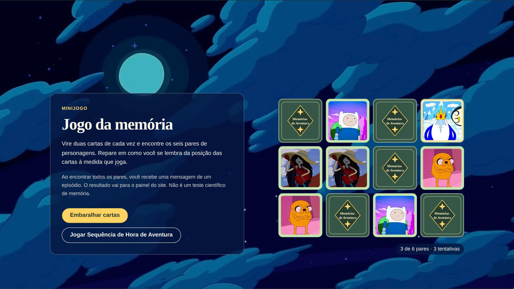
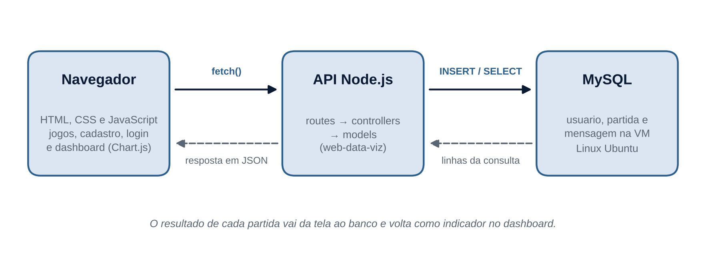
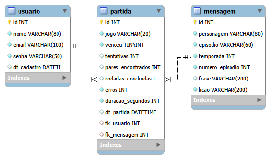

# 🗡️ Memórias de Aventura

> Hora de Aventura, autoconhecimento e neurociência.
> Projeto Individual de **Patrick Scaglia Rodrigues** · Análise e Desenvolvimento de Sistemas · SPTech · 1º semestre (turma A) · 2026.2


---

## 💡 Sobre o projeto

O **Memórias de Aventura** é um site que leva Hora de Aventura para outro lugar: as mensagens que existem por trás dos episódios. Muitos episódios ensinam alguma coisa e podem servir de conforto em momentos difíceis, como o fim de um relacionamento.

No site, o usuário joga dois minijogos personalizados com personagens da série. Ao terminar cada partida, ele recebe uma frase curta ligada a um personagem e o nome do episódio de onde ela vem. Assim, pode levar a lição em poucos segundos ou procurar o episódio para assistir inteiro.

Os resultados das partidas serão gravados no banco de dados e exibidos em um dashboard com indicadores.

---

## 🎯 Por que escolhi este tema?

Comecei a assistir Hora de Aventura entre os oito e os dez anos, no Cartoon Network. Com o tempo, ele virou o meu desenho de conforto: voltei aos episódios em fases difíceis, quando me sentia perdido, e quase sempre uma frase ou uma cena me ajudava. Também é um momento de família, porque meu irmão mais novo e minha mãe sempre assistiram comigo.

Tenho TDAH e sou autista (TEA). Durante toda a vida, fiz jogos de memória e de repetição que me ajudaram a me desenvolver, e isso me fez gostar de neurociência e de autoconhecimento. Os minijogos do site juntam essas duas coisas.

## 🧢 Por que o Finn?

O Finn é corajoso, leal, quer sempre ajudar e sente tudo com intensidade, como eu. Ao longo da série, ele passa pela decepção de não ser correspondido pela Princesa Jujuba e aprende a lidar com isso sem deixar de ser quem é. Esses episódios me ajudaram várias vezes.

> “Ser ruim em alguma coisa é o primeiro passo para ficar meio bom nela.” — Jake, em *His Hero* (tradução livre)

---

## 🎮 Como funciona

| Jogo da memória | Sequência de Hora de Aventura |
| --- | --- |
|  |  |
| Vire duas cartas por vez e encontre os seis pares de personagens. O site conta as tentativas. | Finn, Jake, Marceline e BMO se acendem em uma ordem que você precisa repetir. São 6 rodadas, e você tem 3 vidas. |

Ao final de cada partida, ganhando ou perdendo, aparece a **carta de um episódio**: a foto do personagem, a frase dele (quando já conferida), a lição e o episódio para assistir. A carta não é só sorteada: ela depende de como foi a partida. Quem errou bastante e terminou recebe *His Hero* ("errar faz parte de aprender"); quem chegou longe na Sequência e perdeu recebe *The Hall of Egress* ("persistir também pode significar mudar de estratégia"). Exemplo de frase: em *Puhoy* (T5, ep. 16), Jake diz a Finn: “Você tá se enrolando nos seus problemas imaginários.” As mensagens ficam em [`web-data-viz/public/js/mensagens-episodios.js`](web-data-viz/public/js/mensagens-episodios.js) e as regras da escolha em [`web-data-viz/public/js/carta-episodio.js`](web-data-viz/public/js/carta-episodio.js).

**Conta de usuário:** crie uma conta em `cadastro.html` e entre em `login.html`. Com login, suas partidas ficam salvas no seu nome e o painel mostra quantas você jogou. Sem login, dá para jogar normalmente, e a partida é salva como anônima.

> Os jogos são uma atividade de lazer e reflexão. Não são teste, diagnóstico nem tratamento.

---

## 📊 Dashboard

| Indicador | Cálculo |
| --- | --- |
| Partidas por jogo | contagem de partidas de cada jogo |
| Aproveitamento na memória | pares encontrados (6) ÷ tentativas × 100 |
| Média de rodadas na Sequência | soma das rodadas concluídas ÷ número de partidas |
| Tempo médio por partida | soma das durações ÷ número de partidas |
| Álbum de episódios | cartas diferentes recebidas ÷ 7 cartas |

O painel fica em `/dashboard.html`, exige login e usa Chart.js. Cada pessoa vê só os próprios resultados (as consultas filtram pelo `fk_usuario` de quem está logado): os indicadores, quantas partidas jogou e o álbum com as cartas de episódios que já recebeu (as outras aparecem bloqueadas; clicar numa carta aberta mostra a carta inteira). Partidas jogadas sem login são gravadas, mas não aparecem em nenhum painel. Cada partida terminada é enviada pela API e gravada no MySQL.



---

## 🗄️ Banco de dados

Três tabelas no MySQL:

- **usuario**: quem se cadastra no site;
- **mensagem**: os episódios, as frases e as lições mostradas no fim dos jogos;
- **partida**: o resultado de cada jogo, ligado ao usuário (`fk_usuario`) e à mensagem recebida (`fk_mensagem`).

Os relacionamentos são 1:N: um usuário joga várias partidas, e uma mensagem aparece em várias partidas. O script completo, com as mensagens, dados de teste e as consultas do dashboard (incluindo um JOIN), está em [`banco-de-dados/script.sql`](banco-de-dados/script.sql).

**DER (Diagrama Entidade-Relacionamento)**, gerado no MySQL Workbench a partir do banco `memorias_aventura` (Database → Reverse Engineer). O arquivo do modelo é [`banco-de-dados/der-memorias-aventura.mwb`](banco-de-dados/der-memorias-aventura.mwb) e abre no Workbench.



---

## 📦 Entregáveis

- ✅ Documentação do projeto ([`ti/documentacao.docx`](ti/documentacao.docx))
- ✅ Planejamento no Trello
- ✅ Página Home
- ✅ Minijogos com variáveis, funções, condicionais, repetições e vetores
- ✅ Cadastro e login com validações em JavaScript
- ✅ DER (MySQL Workbench) e relacionamentos
- ✅ Comandos SQL
- ✅ Integração da API Node.js com o MySQL (rotas de partidas)
- ✅ Aplicação de cálculos matemáticos nos indicadores
- ✅ VM Linux contendo somente o banco de dados
- ✅ Dashboard com gráficos (Chart.js)
- ✅ Apresentação para a banca
- ✅ Diário de Prompts ([`docs/diario-de-prompts.md`](docs/diario-de-prompts.md))

---

## 🛠️ Tecnologias

- **Front-end:** HTML, CSS e JavaScript
- **Back-end:** Node.js, com a base Web Data Viz/AquaTech da turma
- **Banco de dados:** MySQL, em uma VM Linux Ubuntu
- **Gráficos:** Chart.js
- **Ferramentas:** Git, GitHub, VS Code e Trello

---

## 📁 Estrutura do repositório

```
projeto-individual-Patrick/
├── banco-de-dados/        → DER (imagem e modelo .mwb do Workbench) e script SQL
├── docs/                  → planejamento, diário de prompts, imagens e histórico
├── ti/                    → documentação acadêmica
├── web-data-viz/          → aplicação (site + API)
│   ├── public/            → páginas, CSS, JavaScript e imagens
│   └── src/               → rotas, controllers, models e conexão com o banco
├── AGENTS.md              → regras para assistentes de IA neste projeto
└── Prototipo_Hora_de_Aventura.html → protótipo histórico (referência)
```

---

## ▶️ Como executar

1. No MySQL (na VM Linux), rode o arquivo `banco-de-dados/script.sql` inteiro.
2. No terminal:

```bash
cd web-data-viz
npm install
cp .env.example .env.dev   # no PowerShell: Copy-Item .env.example .env.dev
```

3. No `.env.dev`, preencha `DB_HOST`, `DB_USER` e `DB_PASSWORD` do seu MySQL (`DB_DATABASE=memorias_aventura`).
4. Rode `npm start` e abra <http://localhost:3333/>. O painel fica em <http://localhost:3333/dashboard.html>.

Se o PowerShell bloquear o `npm`, use `npm.cmd start`.

---

## 🌍 ODS

- **ODS 3 – Saúde e bem-estar:** um momento de pausa e uma mensagem curta de conforto.
- **ODS 10 – Redução das desigualdades:** jogos simples e acolhedores para pessoas neurodivergentes.

---

## 🤖 Uso de IA

A IA é usada como apoio ao aprendizado. Cada uso fica registrado em [`docs/diario-de-prompts.md`](docs/diario-de-prompts.md). O histórico detalhado das etapas anteriores está em [`docs/historico/`](docs/historico/).

---

## 👤 Autor

**Patrick Scaglia Rodrigues** · estudante de Análise e Desenvolvimento de Sistemas na SPTech.

## 📚 Observação

Projeto desenvolvido para fins acadêmicos. Hora de Aventura e seus personagens pertencem aos seus titulares de direitos; as fontes das imagens estão em [`web-data-viz/public/assets/imgs/fontes.md`](web-data-viz/public/assets/imgs/fontes.md).
