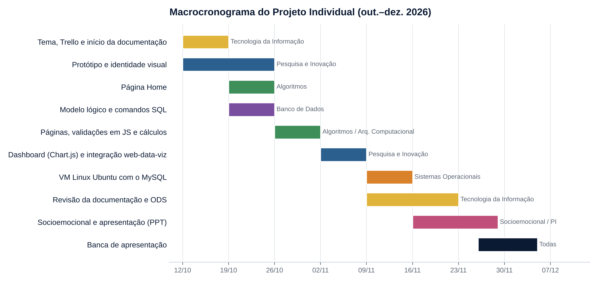

# Planejamento do projeto

Tema: **Memórias de Aventura** — Hora de Aventura, autoconhecimento e neurociência.

O planejamento das tarefas fica no quadro do Trello "PROJETO INDIVIDUAL SPTECH | HORA DE AVENTURA", com as listas A Fazer, Em Andamento, Revisão e Concluído. As etiquetas seguem as disciplinas: Tecnologia da Informação, Algoritmos, Banco de Dados, Arquitetura Computacional, Sistemas Operacionais e Pesquisa e Inovação.

- Requisitos, prioridades e status: [`../ti/backlog-requisitos.xlsx`](../ti/backlog-requisitos.xlsx)
- Documentação completa: [`../ti/documentacao.docx`](../ti/documentacao.docx)

## Macrocronograma

Banca prevista entre 26/11 e 04/12/2026, com 10 minutos de apresentação (datas sujeitas a alteração).
